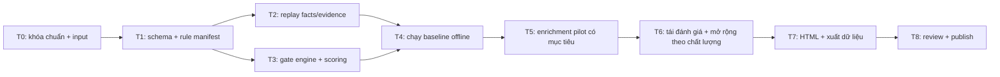

# Áp dụng 5 gate vào v2 — kế hoạch thực thi

> For agentic workers: triển khai theo `subagent-driven-development` khi bắt đầu giai đoạn code, từng task có test và review độc lập. Hiện tại chỉ chuẩn hóa tài liệu, kiểm kê input và planning; không chạy filter mới hay thay giao diện v2 trong lượt lập kế hoạch này.

**Goal:** đánh giá toàn bộ snapshot v2 theo [HOUSING-GATES-v1.0](../standards/HOUSING-GATES-v1.0.md), xuất checklist kiểm được cho từng tin, nhánh nghiên cứu, điểm có mức độ đủ dữ liệu và UI minh bạch.

**Architecture:** input v2 bất biến → chuẩn hóa facts/evidence → gate engine thuần → enrichment theo hàng đợi → scoring → output độc lập → review → xuất bản. Tái sử dụng trang chi tiết đã lưu; không crawl lại toàn SUUMO. Private buyer profile nằm ngoài thư mục public.

**Tech Stack:** Python hiện có, CSV/JSON/SQLite, HTML hiện có, Playwright cho kiểm giao diện, GitHub connector/API cho xuất bản. Không cài thư viện hoặc hệ thống mới nếu chưa có nhu cầu thực tế.

## 1. Các ràng buộc chung

- Chuẩn duy nhất: `policy_version=HOUSING-GATES-1.0`, 5 gate, 42 mục kiểm/chấm điểm, 14 mục điểm tổng 100.
- Dữ liệu đầu vào: catalog v2 có 11.463 URL, baseline 1.754 ứng viên giá exact; kết quả kiểm link cũ 1.751 active / 2 not_found / 1 unverified. Tính lại con số từ file khi chạy, không hardcode kết quả nghiệp vụ.
- Ngày catalog 02/11/2026, kiểm link sang 03/11 JST; policy/run date không đổi ngày nguồn. 6 route new-condo chưa phát hiện phải còn trong coverage.
- Mỗi URL luôn có disposition duy nhất để đối soát. Dự án/giá khoảng có queue riêng; không đánh giá như căn đơn.
- E1 quảng cáo không tự xác nhận tài chính/pháp lý/kỹ thuật. Null khác 0; NOT_EVALUATED khác REVIEW và PASS; bất kỳ FAIL phải có rule và bằng chứng. G4 có score_state riêng, G5 có stage_state; không nhảy gate.
- Chưa có private input thì giữ REVIEW và nghiên cứu có điều kiện, không ra kết luận ngân sách hoặc khả năng mua.
- Bản public không chứa profile, tài chính, giấy tờ cá nhân hoặc đường dẫn máy. Không sao chép dữ liệu thật vào fixtures.
- Không tự thêm tuổi tối đa, diện tích tối thiểu, phút ga tối đa hay ngưỡng stress. Không tự gọi agent/model khác loại được phân công.
- Không sửa `catalog`, `crawl`, `link-audit`, `preferred-link-audit` hoặc `public` lịch sử. Output nằm dưới `gates/<run_id>`; publication mới tách version.
- Chỉ một client SUUMO khi thực sự cần tải thêm; khoảng cách tối thiểu 3 giây hoặc delay lớn hơn của nhóm UA phù hợp; dừng khi 401/403/429/challenge. Không dùng scope mới để bỏ qua access-stop. Không tải thêm nếu cache đủ.
- Dữ liệu nguồn ngoài chỉ thu theo nhu cầu tiêu chí và từ nguồn được phép; không mua dữ liệu, liên hệ bên thứ ba hay gửi hồ sơ. Chỉ dẫn mới về network phải ghi vào run manifest.

## 2. Phân vai theo độ phức tạp

| Vai | Model | Trách nhiệm | Không tự làm |
|---|---|---|---|
| Chủ trì | Agent chính | Suy luận, policy, chốt interface, phân xử review, kiểm nghiệm thu, quyết định có đủ cơ sở xuất bản | Không coi báo cáo subagent là kiểm chứng cuối |
| Terra-Policy/Engine | GPT-6.1 Terra high | State machine, schema, gate dependencies, evidence resolution, scoring intervals, xử lý mâu thuẫn | Không tự thay mục tiêu/ngưỡng cá nhân |
| Terra-Research | GPT-6.1 Terra high | Thiết kế ghép vị trí/hazard/comparables/dự án; đánh giá ý nghĩa, độ phủ, chống cộng trùng | Không kết luận pháp lý hoặc dùng tọa độ thô như vị trí căn |
| Terra-Reviewer | GPT-6.1 Terra high, instance độc lập | Review logic, false-pass/false-fail, provenance, quyền riêng tư, nghiệm thu mẫu | Không tự review phần mình vừa triển khai |
| Luna-Data | GPT-6 Luna medium | Kiểm kê, trích fields theo schema đã chốt, replay HTML, batch offline, xuất CSV/SQLite, đếm và lập missingness | Không tự định rubric hay kết luận căn tốt/xấu |
| Luna-View/Runner | GPT-6 Luna medium | Hiển thị schema đã ổn định, giữ sao, chạy test/script được bàn giao, đóng gói output | Không sửa policy để làm số lượng đẹp hơn |

Tối đa 3 subagent cùng lúc cộng agent chính. Không để hai agent sửa cùng file. Vai có thể dùng lại slot tuần tự; reviewer phải là instance khác người viết task. Không dùng Luna 6.1 vì lựa chọn hiện có và yêu cầu là Luna 6.

**Trong lượt planning:** Terra chỉ review tài liệu; Luna chỉ kiểm kê input đọc local. Các task triển khai dưới đây đều chưa chạy.

## 3. Thứ tự và phụ thuộc



T2 và T3 chạy song song sau khi T1 được parent chốt. T5 có thể chuẩn bị source registry song song T2/T3 nhưng chưa tải hàng loạt hoặc gắn score. T7 chỉ dùng schema đã chốt, không tự thêm nhãn “đạt mua”.

## 4. File và interface dự kiến

| File tạo mới | Trách nhiệm / owner |
|---|---|
| `gate_policy.json`, `gate_models.py` | IDs, weights, enum, rule/applicability và schema — Terra-Engine |
| `gate_extract.py` | Adapt `detail_claims` và CSV sang facts có evidence — Luna-Data |
| `gate_engine.py`, `gate_score.py` | Pure evaluation, state/score không gọi mạng — Terra-Engine |
| `gate_enrichment.py`, `gate_sources.json` | Ghép nguồn ngoài được kiểm chứng, precision, event_id — Terra-Research |
| `run_gate_evaluation.py`, `export_gate_results.py` | Orchestration offline và output riêng — Luna-Data |
| `build_gate_view.py`, `publish_gate_results.py` | View và publisher tách khỏi v2 gốc — Luna-View, parent phụ trách publication |
| `tests/test_gate_policy.py`, `test_gate_extract.py`, `test_gate_engine.py`, `test_gate_score.py`, `test_gate_exports.py` | Fixture synthetic, oracle độc lập, không dữ liệu tài chính thật |

Không đổi hành vi `run_v2_pipeline.py`/`finalize_v2.py` cũ để giả v2 đã chạy gate. Có thể tái dùng helper nhưng không sửa snapshot cũ.

Các interface công khai phải thống nhất từ T1:

```python
load_policy(path: Path) -> dict
extract_facts(row: dict, acquisitions: list[dict]) -> dict
evaluate_listing(facts: dict, policy: dict, buyer_profile: dict | None) -> dict
score_listing(ratings: dict, policy: dict) -> dict
enrich_listing(facts: dict, source_records: list[dict], policy: dict) -> dict
export_results(results: list[dict], output: Path, manifest: dict) -> dict
build_gate_view(decisions_csv: Path, scores_csv: Path, output: Path) -> None
```

`facts`: `listing_url`, `fields`, `evidence`, `conflicts`, `availability`, `scope_hints`. Mỗi field gồm value/raw/evidence_ids/missing_reason; không có giá trị dùng null. `buyer_profile=None` là chưa có dependency tài chính, không phải chi phí bằng 0.

`result`: URL, scope_status, availability, checklist list, gates G1…G5, highest_passed_gate, disposition, blockers, next_actions, evidence references, score object. Score object có item ratings, known_weight, coverage, lower, upper, total (nullable), ranking_eligibility và lý do. `reviewed_rating` do reviewer cung cấp qua file riêng, engine không tự sinh nhận định chủ quan từ keyword quảng cáo.

## 5. Task thực thi và tiêu chí bàn giao

### T0 — Khóa chuẩn, kiểm kê và lưu Git

Owner: parent; Terra review tài liệu, Luna inventory. Đây là deliverable của lượt hiện tại.

- [ ] Lưu chuẩn có ID, checklist, state/evidence, rubric, crosswalk và plan.
- [ ] Review đủ J01–J16/A–H, trọng số 100, nhánh REVIEW không bị gọi PASS.
- [ ] Kiểm số dòng/field/nguồn bằng local file; phân biệt policy đã lưu và engine chưa có.
- [ ] Lưu file public-safe vào `housing/docs/` trên Git; đọc lại so byte/hash; không sửa trang nhà hiện hành.

Exit: docs commit + inventory + review response, không có claim “đã lọc theo gate”.

### T1 — Schema và policy manifest

Owner: Terra-Engine. Reviewer: parent, sau đó Terra-Reviewer khi tích hợp.

- [ ] Viết fixture kỳ vọng 42 ID duy nhất, đủ 14 score item, weight sum 100, mọi J/A–H có mapping.
- [ ] Chạy `python -m unittest discover -s tests -p test_gate_policy.py`; xác nhận lỗi thiếu schema trước khi triển khai.
- [ ] Tạo JSON từ document; validate enum, applicability và required evidence. Không copy dữ liệu người dùng vào policy.
- [ ] Chạy lại test; parent so rule ID/weight/doc. Khóa policy hash và interface để T2/T3 dùng chung.

Ví dụ assertion bắt buộc:

```python
assert sum(x['weight'] for x in policy['score_items']) == 100
assert len({x['id'] for x in policy['criteria']}) == 42
assert policy['missing_state'] == 'REVIEW'
```

Exit: manifest/schema có test; mọi thay đổi sau đó tăng version hoặc có migration rõ ràng trước run thật.

### T2 — Trích facts/evidence từ cache

Owner: Luna-Data. Dependency T1. Reviewer: Terra-Research.

- [ ] Viết fixture giá exact/range/undisclosed, tháng/năm hoàn thành dự kiến, phí tháng/một lần, leasehold, owner-change, đường/khả năng xây lại, nhà liền kề.
- [ ] Chạy `python -m unittest discover -s tests -p test_gate_extract.py` trước/sau implementation.
- [ ] Dùng `detail_claims` hiện có nếu đủ; preserve raw label và acquisition hash/timestamp. Một field nhiều nguồn bất đồng tạo conflict, không âm thầm lấy giá trị thuận lợi.
- [ ] Replay các trang đã lưu của ứng viên; chỉ ghi URL chưa có detail vào missing queue, không tải mới ở T2.
- [ ] Xuất bảng missingness theo category × criterion; kiểm mẫu raw DOM độc lập với parser.

Oracle: `3900–5200万円` không thành exact 3900; `未定` là null; construction future không thành tuổi âm; thiếu phí không bằng 0; parse được `再建築不可` tạo risk claim REVIEW, không tự kết luận pháp lý.

Exit: facts có provenance cho mỗi field, giữ mọi URL và dự án, không network.

### T3 — Gate engine và score engine thuần

Owner: Terra-Engine. Dependency T1. Reviewer độc lập: Terra-Reviewer.

- [ ] Viết unit tests cho status aggregation (FAIL > REVIEW > NOT_EVALUATED > PASS), applicability, scope/disposition priority, consecutive gate, evidence insufficient, conflicts, private missing, G5_stage và NA khoản vay khi mua không vay đã xác nhận.
- [ ] Viết score tests trước implementation: null khác 0, không chuẩn hóa thiếu dữ liệu lên 100, không tự đổi weights do NA, interval overlap không sinh rank chắc chắn.
- [ ] Implement `evaluate_listing` và `score_listing` không I/O mạng; evidence-level decision tách khỏi keyword extraction.
- [ ] Test invariant bằng fixture synthetic: điểm 100 không cứu G2 FAIL; G2 REVIEW vẫn có research record; chưa xác nhận nhu cầu không tạo FAIL.
- [ ] Parent review giao kèo với doc; Terra-Reviewer kiểm false PASS trước khi chạy thật.

Oracle số học: chỉ P1=4 (weight15), các mục khác null → known_weight=15, coverage=.15, lower=15, upper=100, total=null; tất cả14 mục rating2 → total=50; tất cả null → [0,100], không rank. Availability lưu thành field riêng, không xác nhận pháp lý/kỹ thuật; riêng G4 PASS/ranking_eligible đòi active. Test full-score + not_checked → không G4 PASS; full-score + active nhưng G2 REVIEW cũng không G4 PASS.

Exit: pure engine kiểm chứng được, chưa kết luận căn nào đạt.

### T4 — Baseline offline toàn snapshot

Owner: Luna-Data chạy, parent nghiệm thu. Dependencies T2+T3.

- [ ] Tạo run_id thật, manifest hash các input/policy; không dùng ngày chạy làm observed_at.
- [ ] Chạy `python -X utf8 run_gate_evaluation.py --dataset output/ver2.0-20261102 --policy gate_policy.json --mode offline --output <run-directory>`; run-directory là thư mục mới tạo cho lần chạy, script từ chối output đã tồn tại.
- [ ] Đối chiếu total URL/disposition với input; so tập candidate_scope với baseline1754, giải thích mọi sai khác do quy tắc/parse (không ép ra đúng số).
- [ ] Xuất checklist, missing queue, initial scores; dự kiến nhiều REVIEW và chưa có official rank là kết quả hợp lệ.
- [ ] Parent chọn enrichment tranche từ queue, không tự loại hàng còn lại.

Exit: baseline thật có số từng gate và lý do, cho thấy phần cần bổ sung; không có full-score giả.

### T5 — Enrichment pilot theo tiêu chí

Owner: Terra-Research thiết kế/đánh giá; Luna-Data tải hoặc batch theo adapter đã review. Không chạy hai client SUUMO đồng thời.

- [ ] Lập `gate_sources.json`: tiêu chí, cơ quan nguồn, URL/dataset/version/date, độ chính xác, phép dùng, lịch sử, giới hạn; ưu tiên nguồn chính thức Osaka/MLIT/chủ dự án. Kiểm URL hiện hành khi thực thi, không đoán endpoint.
- [ ] Chọn pilot tối đa24 ứng viên: mỗi tổ hợp 3 loại unit thực có ×4 vùng bắc/nam/đông/tây tối đa2; thiếu strata thì ghi thiếu, không bù bằng gọi mẫu đại diện thị trường. Thêm tối đa8 project cases riêng, không trộn điểm căn.
- [ ] Kiểm vị trí/cửa ga và đường đi; nguồn địa chỉ mờ giữ precision thấp. Hazard only join ở độ chính xác phù hợp; không kết luận từ tâm quận.
- [ ] Ghép nguồn giao dịch phù hợp, dân cư theo kỳ/địa giới, dự án theo stage/event_id, nguồn cung cùng phân khúc. Ghi matched/unmatched/conflict, không biến không có nguồn thành không có rủi ro.
- [ ] Terra-Research lập comparison memo/rubric_revision theo cohort và trình parent khóa mốc 0/2/4 cùng cách xác định 1/3 trước khi chấm. Viết rationale từng rating đủ bằng chứng; mục phụ thuộc private/hồ sơ để null. Ledger effect_id→score_owner_id ngăn cộng trùng. Terra-Reviewer audit ít nhất các ca đầy đủ/thiếu/mâu thuẫn/đang xây.

Budget pilot đề xuất: tối đa60 request bổ sung SUUMO gồmrobots nếu cần, tốc độ theo policy; ưu tiên cache. Nguồn ngoài tối đa100 request công khai theo giới hạn từng nhà cung cấp, ưu tiên dataset dùng chung; stop khi truy cập bị chặn. Budget là trần công việc của kế hoạch, không chỉ tiêu phải dùng hết.

Exit: chứng minh một chuỗi evidence→rating→gate có thể truy lại; chưa mở rộng khi còn false-pass nghiêm trọng hoặc ghép sai vị trí.

### T6 — Mở rộng đánh giá theo kết quả pilot

Owner: parent chốt phạm vi; Terra-Research xử lý suy luận, Luna-Data chạy adapter.

- [ ] Reviewer xác nhận oracle giá/quyền/tọa độ và chống double-count đạt; nếu không, sửa và replay pilot trước.
- [ ] Ưu tiên nguồn dùng chung cho toàn v2 (dự án/dân cư/cung), sau đó enrich theo tranche100 ứng viên từ research queue; lưu checkpoint mỗi URL/source.
- [ ] Tái đánh giá toàn bộ records sau mỗi tranche, không xóa ứng viên ngoài tranche. Không tự chạy vượt budget T5; parent lập budget bổ sung cụ thể dựa trên missingness và báo trước phạm vi.
- [ ] Mục không thể xác minh công khai chuyển hồ sơ yêu cầu người mua/chuyên gia, không kéo dài crawl để giả đã giải quyết.
- [ ] Xuất coverage, số record có rating, số gate REVIEW, lỗi theo nguồn; phân biệt full ranking với thứ tự ưu tiên nghiên cứu.

Exit có thể là danh sách nghiên cứu được làm giàu một phần; phải công bố phạm vi và missingness. Không yêu cầu đạt đủ điểm bằng mọi giá.

### T7 — View và artifact có thể kiểm

Owner: Luna-View. Reviewer: parent + Terra-Reviewer.

- [ ] Viết fixtures cùng gate PASS/REVIEW/FAIL, điểm thiếu, project, expired và private dependency.
- [ ] Build HTML từ decision/score CSV: trạng thái từng gate, lý do, link evidence, timestamp, next action; không hiển thị chỉ một điểm gây hiểu nhầm.
- [ ] Giữ canonical URL và key `osaka-housing:stars:v1`; danh sách mới phải đọc được sao cũ, không xóa sao của tin không còn trong view.
- [ ] Kiểm390px/320px, filter/type/ward/gate, sao rồi reload, localStorage lỗi và no-JS; CSV/SQLite/cardcount cùng bộ lọc phải khớp.
- [ ] Verify export không private profile/reference/path; manifest hash từng artifact. Xử lý file SQLite nén khi xuất bản như v2 hiện có.

Exit: UI đọc được trên điện thoại, cho thấy cả nhánh REVIEW; không thay mặc định bằng danh sách rỗng vì chưa có hồ sơ ngân hàng.

### T8 — Review cuối và xuất bản riêng

Owner: Terra-Reviewer độc lập; parent quyết định xuất bản, Luna chạy lệnh đã duyệt.

- [ ] Chọn tối thiểu30 URL phân tầng category/disposition, gồm project/giá khoảng/thiếu/expired/mâu thuẫn; cộng tất cả ca FAIL hiếm trong pilot nếu dưới10. So với raw evidence, không chỉ CSV do cùng parser tạo.
- [ ] Kiểm không false-pass tài chính/pháp lý, false-fail vì thiếu data, điểm cộng trùng, mẫu số/đơn vị sai. Lỗi trọng yếu → dừng xuất bản và replay phần bị ảnh hưởng.
- [ ] Đối soát counts, input hashes unchanged, SQLite integrity, score bounds, mapping, freshness và privacy; lưu review và response.
- [ ] Publish `housing/ver2.0-20261102-gates-<run_id>/` sau khi đủ nghiệm thu; version v2 cũ còn nguyên. Chỉ đổi trang index hiện hành khi bản mới có giao diện queue rõ ràng và được parent kiểm nội dung.
- [ ] Đọc lại Git blobs/hash và kiểm Pages thực; receipt ghi commit, URL, policy hash, coverage. Báo rõ bao nhiêu căn đã qua gate nào, bao nhiêu chỉ là research candidates.

Exit: bản công khai kiểm được, không hứa kết quả mua/tăng giá, không có hành động giao dịch thay người dùng.

## 6. Tiêu chí kết thúc theo mức deliverable

| Mức | Có thể xác nhận hoàn thành khi |
|---|---|
| Tài liệu/planning (lượt này) | Spec+plan+inventory+review đã lưu local/Git, các mâu thuẫn trọng yếu được xử lý |
| Filter baseline | Mọi URL có checklist/disposition có thể truy lại; thiếu dữ liệu giữ đúng trạng thái |
| Research enrichment | Những tranche đã công bố có provenance và review; phần chưa phủ công khai |
| Xếp hạng đầy đủ | Chỉ trong cohort đủ điều kiện gate và 100% score coverage; nếu chưa có căn nào thì công bố chưa đủ |
| Đủ điều kiện mua | Chỉ khi G5 hoàn tất với người mua/chuyên gia; không thuộc nhiệm vụ tự động hóa crawl |

Không có deadline giả trước khi kiểm khối lượng evidence. Đo throughput ở T2/T5 rồi cập nhật ước tính cho từng tranche. Khâu thiếu dữ liệu private/hồ sơ không cản việc hoàn thành baseline và research view, nhưng vẫn cản kết luận đủ điều kiện mua.

## 7. Checklist tự review kế hoạch

- [ ] Từng gate và mọi ID có task thực hiện/kiểm chứng; J01–J16 và A–H không thất lạc.
- [ ] T2/T3 có interface chung; không trùng file ownership; reviewer không tự duyệt code của mình.
- [ ] Ngưỡng cá nhân chưa xác nhận không thành filter cứng; nhóm new-condo/project giữ queue.
- [ ] Phân biệt snapshot date, evidence date, evaluation date; không chạy crawl toàn bộ chỉ để làm mới nhãn.
- [ ] Không gọi nghiên cứu có điều kiện là qua gate; không tự hoàn thiện điểm bằng suy đoán.
- [ ] Phạm vi publication không bao gồm dữ liệu cá nhân; bản v2 hiện tại không đổi trong lượt planning.
