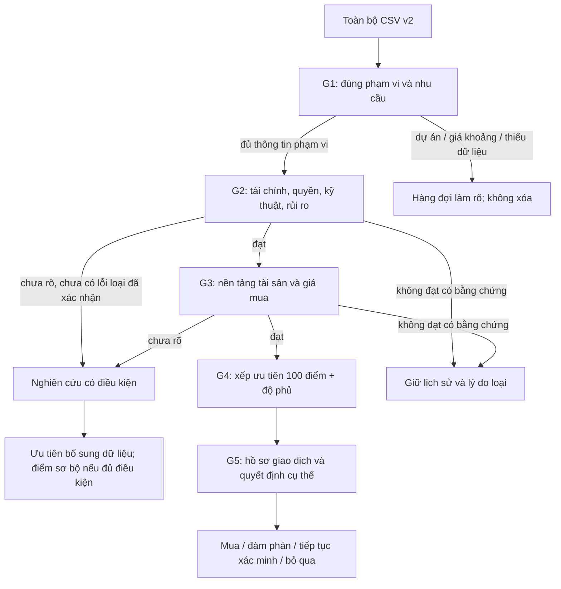

# Chuẩn đánh giá nhà Osaka — 5 gate, phiên bản 1.0

Ngày chuẩn hóa: 03/11/2026 (JST). Chủ trì thiết kế: agent chính theo yêu cầu người dùng.

**Mục đích:** làm chuẩn triển khai filter và xếp ưu tiên cho dữ liệu `ver2.0-20261102`. Đây là chính sách nghiên cứu/ra quyết định của dự án, không phải tiêu chuẩn pháp lý quốc gia, mô hình dự báo tăng giá hay xác nhận đủ điều kiện vay.

**Trạng thái:** đã chuẩn hóa tài liệu để triển khai; chưa chạy gate engine trên v2. Trọng số và quy tắc bên dưới là thiết kế vận hành v1.0, chưa được hiệu chuẩn bằng kết quả giao dịch. Chỉ thay đổi qua phiên bản chính sách mới, không sửa ngầm sau khi thấy thứ hạng.

## 1. Quan hệ với ba tài liệu gốc

| Nguồn | Vai trò trong chuẩn hợp nhất |
|---|---|
| [CRITERIA.md](../../CRITERIA.md), tám nhóm A–H | Lớp phân tích vị trí, thị trường, giá, rủi ro và tài sản; chủ yếu G2–G4 |
| [Bộ Osaka](../../report/bo-tieu-chuan-mua-nha.html) | Mục tiêu cá nhân, giữ tài sản dài hạn, ưu tiên giá/chất lượng/bán lại; tiện ích cá nhân là phụ |
| [Bộ Nhật + review Osaka](../../report/tieu-chuan-mua-nha-nhat-va-review-osaka.html), J01–J16 | Nền thẩm định, hồ sơ và kiểm soát giao dịch; chủ yếu G1–G3 và G5 |

Chuẩn này thay thế cách ghép các tài liệu khi triển khai gate engine mới, không xóa hoặc sửa tài liệu lịch sử. Khi mâu thuẫn: chỉ dẫn mới của người dùng > cấu hình cá nhân đã xác nhận > chuẩn này > đề xuất cũ. Không biến các ngưỡng tuổi nhà, phút đi bộ, tỷ lệ chi nhà hay số tháng dự phòng trong tài liệu cũ thành điều kiện loại tự động.

Phân biệt phiên bản: `policy_version=HOUSING-GATES-1.0`, `dataset_version=ver2.0-20261102`, `evaluation_run_id` là ngày/giờ thực chạy. Ngày version dữ liệu không phải ngày cập nhật tất cả bằng chứng.

## 2. Flow: phễu quyết định và nhánh nghiên cứu

**Không có PASS tạm:** nghiên cứu tiếp không đồng nghĩa vượt gate. Nếu tài chính cá nhân còn thiếu, mọi căn liên quan giữ G2=REVIEW; vẫn được phân tích vị trí/tài sản trong nhánh nghiên cứu. Chỉ danh sách đã PASS G1–G3 mới được gọi là đủ điều kiện xếp ưu tiên thẩm định cuối; không gọi đó là đủ điều kiện mua.

Có thể đọc và chuẩn bị bằng chứng G3/G4 song song để tiết kiệm thời gian. `highest_passed_gate` chỉ tính chuỗi PASS liên tiếp, không nhảy qua G2 chưa đạt. G4 là tầng sắp thứ tự, không phải một ngưỡng điểm loại nhà.

## 3. Hợp đồng trạng thái và bằng chứng

Mỗi mục checklist có: `criterion_id`, `applicability`, `status`, `reason_code`, `evidence_ids`, `checked_at`, `reviewer`, `next_action`, `owner`, `due_before`. Mỗi record gắn URL tin; chỉ thêm property_id khi đủ bằng chứng ghép căn.

| Giá trị | Nghĩa và điều kiện |
|---|---|
| PASS | Đủ bằng chứng phù hợp cấp độ tiêu chí; điều kiện đã đáp ứng |
| REVIEW | Thiếu, lỗi, cũ, mâu thuẫn, chưa có ngưỡng cá nhân hoặc chưa có người có thẩm quyền xác minh |
| NOT_EVALUATED | Chưa thực hiện việc đánh giá mục này; không đồng nghĩa đã kiểm và thiếu hồ sơ |
| FAIL | Bằng chứng xác nhận vi phạm điều kiện đã xác định; có rule_id và lý do cụ thể. Không FAIL chỉ vì không tìm thấy dữ liệu |
| NA | Không áp dụng theo loại tài sản/tình huống, có lý do; không dùng để né mục chưa biết |

Gate bắt buộc: FAIL > REVIEW > NOT_EVALUATED > PASS; bỏ NA khỏi phép gộp; tất cả mục áp dụng PASS thì PASS. Một gate không có mục áp dụng là lỗi cấu hình, không tự PASS. Các mục chỉ ghi nhận sở thích chưa chốt được NA với lý do `preference_not_configured`, không chặn G1; phải xuất riêng danh sách sở thích chưa chốt. Gate phía sau chưa chạy là NOT_EVALUATED, dù gate trước đã FAIL; nếu chủ động nghiên cứu song song thì lưu kết quả thực, nhưng không nâng highest_passed_gate qua một gate trước chưa PASS.

`scope_status` tách khỏi gate: `in_scope`, `out_of_scope`, `project_queue`, `scope_review`. Giá ngoài vùng mong muốn là ngoài phạm vi shortlist chính, không chứng minh nhà xấu. `availability` cũng tách riêng: active/expired/not_found/unverified/network_error/not_checked; link còn mở không chứng minh còn bán hoặc pháp lý tốt.

**Cấp bằng chứng:** E1 quảng cáo/nguồn thứ cấp; E2 nguồn chính thức, giao dịch hoặc quan sát có phạm vi phù hợp; E3 hồ sơ tài sản/kiểm định/hợp đồng/báo giá xác nhận bởi chủ thể có thẩm quyền. E2 không tự đủ cho mọi kết luận của E3. Không nâng E1 thành E3 vì đã parse được hoặc thấy cùng nội dung ở nhiều môi giới.

Evidence phải giữ `source_url_or_private_ref`, ngày quan sát, ngày hiệu lực/nội dung, raw claim, hash khi có file, cấp bằng chứng, độ chính xác vị trí, phạm vi áp dụng và mâu thuẫn. Tọa độ tâm quận/phường không dùng để kết luận hazard cho căn. Bằng chứng từ cache giữ timestamp gốc; chạy lại ngày mới không làm dữ liệu mới hơn.

Không có một TTL chung giả định cho mọi nguồn. Tin/giá phải xác nhận lại trước đề nghị mua; dự án và bản đồ phải lưu phiên bản và kiểm nguồn mới nhất trước kết luận; giấy tờ phải xác nhận còn áp dụng tại thời điểm giao dịch. Chính sách freshness theo từng nguồn được ghi vào run manifest; chưa kiểm độ mới thì đánh dấu `freshness_unchecked`.

## 4. G1 — Đúng phạm vi và nhu cầu

Mục tiêu: lập tập ứng viên, tách các hàng đợi; không dùng điều kiện chưa được người dùng xác nhận để loại.

| ID | Checklist cần kiểm | Bằng chứng/field và quy tắc | Khi chưa đủ / người xử lý |
|---|---|---|---|
| G1-01 | Địa chỉ thuộc Osaka-shi | Địa chỉ/quận từ nguồn; mâu thuẫn URL–địa chỉ cần kiểm. Ngoài thành phố → out_of_scope | REVIEW / parser rồi reviewer |
| G1-02 | Nhà riêng hoặc căn hộ; mới/cũ xác định | `category`, nguyên văn loại tài sản. Nhà liền kề/terrace/thuê đất gắn subtype, không giả như nhà độc lập | REVIEW / parser |
| G1-03 | Giá cụ thể trong 40–50 triệu JPY, gồm hai đầu | Giá exact cùng một căn; không dùng giá thấp nhất dự án. Ngoài dải → out_of_scope; dự án/giá khoảng → project_queue | REVIEW nếu giá không rõ / parser |
| G1-04 | Phân biệt tin–căn–dự án; trùng URL | URL chuẩn, ID nguồn, loại tin. Giữ mọi raw row và mapping; chỉ khử bản sao URL ở view unique; nghi cùng căn giữ duplicate_group, không gộp cưỡng bức | REVIEW nếu identity mâu thuẫn / reviewer |
| G1-05 | Có thể dùng để ở theo nhu cầu đã chốt | Hiện trạng cho thuê/owner-change, ngày bàn giao, quyền sử dụng. Quảng cáo vấn đề → REVIEW; chỉ FAIL khi xác nhận không thể đáp ứng nhu cầu đã chốt | REVIEW / hồ sơ + người mua |
| G1-06 | Đáp ứng nhu cầu tối thiểu đã xác nhận | Phòng, diện tích, thang máy/cầu thang, chỗ xe, thú nuôi, điểm đến và hạn đi làm. Chỉ so các trường có cấu hình được duyệt | Chưa cấu hình → NA; đã cấu hình nhưng thiếu data → REVIEW |

`candidate_scope` xác định từ G1-01…04; PASS G1 còn đòi G1-05 và các nhu cầu G1-06 đang áp dụng. Do đó ứng viên theo giá chưa mặc nhiên PASS G1. Link availability là lớp vận hành: expired/not_found loại khỏi view đang xem được, giữ lịch sử; unverified vào hàng đợi. Không tải lại toàn bộ URL chỉ để thực hiện gate này.

## 5. G2 — Có thể mua và nắm giữ

Đây là kiểm tra trở ngại trọng yếu, không phải chứng nhận bằng tin rao. Tài chính là dependency chung của người mua, tính một lần theo kịch bản rồi gắn tác động từng căn; không bắt thu thập lặp cho hàng nghìn tin.

| ID | Checklist cần kiểm | Điều kiện PASS / bằng chứng bắt buộc | Trường hợp chưa rõ hoặc FAIL |
|---|---|---|---|
| G2-01 | Đủ vốn tại từng mốc thanh toán | Hồ sơ riêng: giá, phí/thuế, sửa, tiền cọc, giải ngân; không đếm cùng khoản hai lần | Thiếu thu nhập/chi/nợ/dự toán → REVIEW; xác nhận thiếu vốn không có phương án → FAIL |
| G2-02 | Dòng tiền và dự phòng chịu được | Kịch bản cơ sở + stress đã thống nhất; khoản vay, chi sở hữu và nghĩa vụ khác; không cần tăng giá để trả nợ | Không tự áp 30%/40% hay 12 tháng như luật; ngưỡng chưa chốt → REVIEW |
| G2-03 | Khoản vay khả thi cho người mua và căn này | Báo giá/đánh giá ngân hàng phù hợp giai đoạn, lãi/kỳ hạn/phí/điều kiện, bảo hiểm khoản vay; G5 xác nhận cuối | Không có báo giá → REVIEW; vĩnh trú không thay phê duyệt |
| G2-04 | Quyền mua và sử dụng rõ | Đăng ký, chủ thể/ủy quyền, thuê đất/thời hạn/nghĩa vụ, người thuê, xử lý thế chấp và bàn giao | E1 chỉ tạo cờ; xác nhận quyền không giải quyết được cho mục đích ở → FAIL |
| G2-05 | Đất/đường/xây lại và hạ tầng dùng được | Hồ sơ đường, ranh, setback, quyền đi/đào, quy hoạch và chuyên môn kiểm chứng phương án sửa/xây cần thiết | Nhà riêng bắt buộc; căn hộ kiểm phần đất chung liên quan. Không dùng số mét đường đơn lẻ để xác nhận pháp lý |
| G2-06 | Không có vấn đề kỹ thuật trọng yếu chưa kiểm soát | Hồ sơ xây dựng/chịu động đất, kiểm định thực trạng, lịch sửa và phương án chi phí cho lỗi trọng yếu | Năm xây/ảnh đẹp không đủ PASS; lỗi không khắc phục được trong ngân sách đã chốt → FAIL |
| G2-07 | Rủi ro vị trí có phương án chấp nhận | Định vị đủ chính xác, lớp hazard đúng kịch bản, lối thoát/thiết bị, tổn thất còn lại và phương án bảo hiểm | Tâm quận/thiếu hồ sơ → REVIEW; không tự FAIL mọi vùng có màu hazard |
| G2-08 | Nghĩa vụ quản lý/sửa lớn không có trở ngại chưa xử lý | Căn hộ: quy chế, quỹ/nợ/kế hoạch/thu bổ sung; nhà riêng: nghĩa vụ đường chung/đất chung nếu có | Phí tháng thấp không đủ PASS; phần không áp dụng phải giải thích NA |

G2-01…03 là private. Bản public chỉ ghi `private_review_required`, không xuất số tiền, thu nhập, nợ, tình trạng cư trú cá nhân hoặc hồ sơ ngân hàng. Không liên hệ ngân hàng/môi giới hay gửi hồ sơ thay người dùng trong nhiệm vụ dữ liệu này.

Nếu phương án mua không vay đã được xác nhận, G2-03 và phần vay/bảo hiểm khoản vay của G5-04 là NA; phần vốn/bảo hiểm tài sản/lịch thanh toán vẫn áp dụng. Chưa biết phương án tài trợ là REVIEW. G1-05: chưa chốt ngày cần ở thì không tự đặt hạn bàn giao; tình trạng người thuê/quyền sử dụng còn mơ hồ vẫn REVIEW khi ảnh hưởng mục đích để ở.

## 6. G3 — Nền tảng tài sản và giá mua

Mục tiêu: có lý do sở hữu ngay cả khi giá không tăng. Gate đánh giá tính đầy đủ và chấp nhận của phương án, không dùng tổng điểm G4 để tự PASS.

| ID | Checklist cần kiểm | Điều kiện/đầu ra cần có | Nguồn ưu tiên và xử lý thiếu |
|---|---|---|---|
| G3-01 | Giá mua so với tài sản tương đồng | Bộ comparables cùng loại/quyền, diện tích/tuổi/vị trí/kỳ; điều chỉnh có giải thích; khoảng giá trị và mức bất định | Giao dịch E2; giá rao chỉ so giá rao. Thiếu mẫu phù hợp → REVIEW, không gắn nhãn rẻ |
| G3-02 | Tổng chi phí vào ở và giữ 10/20 năm | Tách phí mua, sửa ban đầu, phí định kỳ, sửa lớn và chi phí bán; không đếm gốc vay hai lần | Hồ sơ/phí/báo giá; thiếu khoản trọng yếu → REVIEW |
| G3-03 | Chất lượng và bảo trì có cơ sở | Căn hộ: quản lý/quỹ/kế hoạch/thực hiện. Nhà riêng: đất, kết cấu, mái/ống/chống thấm, khả năng sửa | E3; E1 không đủ kết luận chất lượng thực |
| G3-04 | Có nhóm người mua/thuê ở thực phù hợp | Kiểu hộ, quy mô căn, mạng việc làm/kết nối hiện hữu và nhu cầu phân khúc | Thống kê E2 cùng địa giới/kỳ; tăng dân số thành phố không thay bằng chứng phân khúc |
| G3-05 | Khả năng thoát sau 10/20 năm | Tuổi khi bán, thời hạn quyền đất, khả năng tiếp cận/cải tạo, nhóm người mua tiếp, rủi ro vay/bán | Không giả định luôn được cho thuê bằng khoản vay để ở; cần điều kiện thực |
| G3-06 | Kịch bản không tăng giá và bán sớm vẫn được hiểu | Tách giá trị tài sản, dòng tiền chủ nhà và lợi ích ở; chi phí thoát và dư nợ; ghi rõ giả định | Không gán tăng giá/xác suất mặc định; người mua chấp nhận kịch bản trước PASS |

PASS G3 yêu cầu mỗi mục áp dụng có evidence và nhận định reviewer rõ ràng; không có ngưỡng tài chính/định giá được chấp thuận thì REVIEW. FAIL là mâu thuẫn đã xác nhận với điều kiện của người mua, không phải kết luận tự động từ giá cao hơn trung vị.

G3-06 phải xem thêm giảm giá và bán chậm theo mức stress được ghi rõ là giả định; không có xác suất mặc định. G3-03 gồm chứng từ hiệu suất năng lượng, thông gió/ẩm, quyền cải tạo và giới hạn của kiểm định; không dùng cải tạo nội thất để chứng minh chịu động đất.

## 7. G4 — Một thang 100 điểm, không trùng nguyên nhân

Chỉ áp cho từng căn/nhà đủ xác định, không trộn điểm dự án với căn. Điểm là công cụ ưu tiên thẩm định, không phải xác suất tăng giá hoặc khuyến nghị mua.

Mỗi mục có `rating` 0–4 hoặc null. 0 = bất lợi đáng kể có bằng chứng; 1 = yếu hơn nhóm so; 2 = tương đương/không có lợi thế sau khi đã kiểm; 3 = có lợi thế rõ; 4 = lợi thế mạnh được kiểm chứng. Null = chưa biết, không phải 0 hoặc 2. Reviewer phải ghi nhóm so, evidence và lý do mức điểm; chỉ gán mức bằng quy tắc chuyên biệt trong bảng, không suy từ vẻ hấp dẫn của quảng cáo.

| ID | Nhóm / trọng số | Nội dung kiểm để cho điểm và ranh giới tránh trùng |
|---|---|---|
| G4-P1 | Giá mua / 15 | Giá vào so giao dịch đã điều chỉnh: 0 bất lợi lớn không giải thích; 2 tương đương; 4 lợi thế lớn đã đối chiếu khác biệt/rủi ro. Không dùng giảm giá quảng cáo làm bằng chứng rẻ |
| G4-P2 | Chi phí sở hữu / 10 | Chi phí 10/20 năm so sản phẩm thay thế: 0 nghĩa vụ cao chưa có lợi ích tương ứng; 2 tương đương; 4 lợi thế chi phí bền vững có hồ sơ. Không cộng lại chênh giá mua P1 |
| G4-Q1 | Chất lượng hiện tại / 10 | Kiểm định và mức sử dụng còn lại: 0 thiếu sót đáng kể đã xác minh; 2 mức thông thường; 4 chất lượng tốt chứng minh bằng hồ sơ/thực trạng. Không lấy mới xây làm 4 tự động |
| G4-Q2 | Năng lực bảo trì / 10 | Quản lý/quỹ/thực hiện với condo; kế hoạch sửa và khả năng thực hiện với nhà riêng: 0 yếu đã xác minh; 2 đủ mức thông thường; 4 bền vững có lịch sử/nguồn lực. Chi phí tuyệt đối chỉ ở P2 |
| G4-Q3 | Thích ứng dài hạn / 5 | Mặt bằng, tiếp cận, quyền và khả năng cải tạo theo tuổi khi bán: 0 hạn chế đáng kể; 2 thông thường; 4 linh hoạt hơn nhóm so, có chứng cứ |
| G4-L1 | Cầu ở thực / 10 | Hộ mục tiêu và việc làm đa dạng, dữ liệu đúng phân khúc: 0 suy yếu; 2 ổn định; 4 mạnh/đa dạng có chuỗi dữ liệu. Không đếm lượt khách du lịch là người mua ở |
| G4-L2 | Kết nối hiện hữu / 8 | Tuyến/cửa ga/đường đi thực và điểm đến thị trường: 0 bất tiện tương đối; 2 tương đương; 4 lợi thế rõ so nhóm so. Không đưa ga chưa mở vào mục này |
| G4-L3 | Cạnh tranh và khả năng bán lại / 7 | Sản phẩm thay thế, cung sắp bàn giao, nhóm mua tiếp và giao dịch: 0 cạnh tranh bất lợi; 2 cân bằng; 4 khan hiếm có cầu chứng minh. Ít tin không tự có điểm cao |
| G4-U1 | Giao thông tương lai / 5 | Cơ chế cải thiện tiếp cận đúng căn, tiến độ/nguồn chính thức: 0 tác động ròng xấu; 2 đã kiểm và không có lợi thế; 4 cải thiện mạnh có cơ sở triển khai. Ý tưởng chưa chắc chắn tối đa 2; chưa nghiên cứu là null |
| G4-U2 | Tái phát triển/việc làm tương lai / 5 | Công năng, tiến độ, đối tượng hưởng lợi, tiếng ồn/che sáng/cung mới: 0 ròng xấu; 2 không lợi thế; 4 lợi ích ròng mạnh có bằng chứng. Ý tưởng tối đa 2 |
| G4-U3 | Lợi ích còn lại sau mức giá đã phản ánh / 5 | Kiểm mức premium hiện tại so khu/căn thay thế và chi phí hưởng lợi: 0 kỳ vọng đắt/rủi ro bất lợi; 2 không thấy upside thêm; 4 lợi ích chưa phản ánh có bằng chứng so sánh. Thiếu comparables → null |
| G4-S1 | Di chuyển cá nhân / 4 | Cửa–cửa tới điểm đến người dùng xác nhận, giờ/đổi tàu/tiếp cận: 0 không thuận; 2 đáp ứng thông thường; 4 rất phù hợp. Chưa biết điểm đến → null |
| G4-S2 | Giáo dục/chăm sóc / 2 | Nhu cầu cụ thể, tuyến trường/chỗ học thực, lộ trình: 0 không phù hợp; 2 đáp ứng; 4 phù hợp rõ. Không suy trường tốt từ gần trường |
| G4-S3 | Tiện ích và môi trường / 4 | Mua sắm/y tế/công viên, nắng/ồn, tiếp cận sinh hoạt: 0 bất lợi; 2 thông thường; 4 lợi thế được kiểm. Không dùng lại ga/dự án làm điểm độc lập |

Các mức 1 và 3 là bằng chứng nằm giữa hai mốc liền kề, reviewer phải giải thích. Tổng nhóm: P=25, Q=25, L=25, U=15, S=10. Điểm pháp lý/an toàn không nằm trong 100 điểm; đó là điều kiện gate.

### Tính điểm và độ phủ

- `known_weight = sum(weight)` của mục có rating và bằng chứng đủ cấp/phạm vi; `coverage = known_weight / 100`.
- `score_observed = sum(weight * rating / 4)` trên mục đã biết; không hiển thị riêng như điểm tổng khi coverage <100%.
- `score_lower = score_observed`; `score_upper = score_observed + (100-known_weight)`. Đây là biên do thiếu dữ liệu, **không phải khoảng tin cậy thống kê**. Không chuẩn hóa điểm đã biết lên 100.
- Chỉ ghi `score_total/100` khi đủ 100 điểm trọng số có bằng chứng. Khi thiếu, hiển thị khoảng, coverage, số mục thiếu và điểm theo từng nhóm.
- NA trong thang điểm không được phân bổ lại trọng số tùy căn. Nếu người mua không cần giáo dục, cần profile trọng số mới áp nhất quán cho toàn cohort; cho đến lúc đó S2=null. NA hợp lệ của checklist G1–G3/G5 không làm tăng điểm G4.
- Không xuất thứ hạng số chung cho các căn chưa đủ dữ liệu. Với cùng loại nhà và cùng profile: chỉ kết luận A chắc hơn B theo thang hiện tại khi lower(A)>upper(B); khoảng chồng lấn → chưa phân thứ tự. Full-score xếp giảm dần; hòa điểm giữ đồng hạng. Không gọi đây là chắc chắn hơn về giá tương lai.
- Hàng đợi nghiên cứu có thể sắp bằng lower giảm dần, coverage giảm dần, URL để ổn định, nhưng phải ghi `research_priority`, không gọi là thứ hạng đầu tư. Căn có lỗi trọng yếu chưa giải quyết luôn nằm ở nhóm riêng, không bị điểm cao che khuất.

`event_id` chung cho một dự án/ga và các tác động liên quan. L2 chấm kết nối đang vận hành, U1 chấm thay đổi tương lai; cùng một cải thiện không cho cả hai. L3 đo cung/cầu thay thế, U3 kiểm premium; P1 đo mức giá mua so chất lượng hiện tại. Reviewer ghi `double_count_check` cho các cặp P1/U3, L1/U2, L2/U1 và L3/U2. Nếu chưa phân tách được tác động, mục phụ thuộc để null kèm `overlapping_evidence`.

### Điều kiện score, cohort và G4

- `score_state=COMPLETE` khi đủ14 rating có evidence đạt yêu cầu; còn lại INCOMPLETE; chưa chạy scoring là NOT_EVALUATED. G4 chỉ PASS khi G1–G3 PASS, availability=active, score_state=COMPLETE và kiểm double-count hoàn tất. Có điểm đầy đủ nhưng G2 REVIEW → G4 REVIEW; điểm thấp không tự FAIL G4.
- `gate_qualified` = G1–G3 PASS. `ranking_eligible` = gate_qualified + active + score COMPLETE + double-count clear. Chỉ ranking_eligible mới thuộc ranked_ready. Gate-qualified nhưng score thiếu ở review_required với reason `score_incomplete`.
- Cohort cố định theo loại nhà, mới/cũ, quyền đất, policy/profile version. Comparables phải thêm diện tích/tuổi/vùng tiếp cận/kỳ giao dịch phù hợp; reviewer công bố cách chọn và khác biệt. Không so rank condo với nhà riêng hoặc đổi cohort riêng để nâng một căn.
- P1 cần giao dịch E2 phù hợp và adjustment memo; P2 cần khoản chi trọng yếu E2/E3; Q1/Q2/Q3 cần hồ sơ/quan sát E3 đúng nội dung; L1/L3 cần dữ liệu thị trường/thống kê E2; L2 cần tuyến/cửa ga/lộ trình E2; U1/U2 cần tiến độ chính thức E2; U3 cần P1 cùng evidence premium; S1 cần nhu cầu đã xác nhận + lộ trình; S2 cần nhu cầu + nguồn trường/cơ sở; S3 cần nguồn tiện ích và quan sát phù hợp. Không đủ cấp/phạm vi, conflict chưa giải quyết hoặc freshness chưa kiểm thì rating=null.
- “Lợi thế lớn” không có ngưỡng số phổ quát trong chuẩn này: không cho agent tự suy số. Trước chấm từng cohort, Terra đề xuất comparison memo có ranh giới 0/2/4 và cách nội suy 1/3 theo dữ liệu thực; parent duyệt và khóa `rubric_revision`. Chưa có memo → rating null. Nếu thay rubric, chấm lại toàn cohort, không sửa riêng một căn.
- Evidence ledger có evidence_id → claim_id → effect_id → score_owner_id. Cùng effect chỉ có một score owner; E1 được dùng để định hướng nghiên cứu, không làm nguồn duy nhất để đạt full score. L2 và S1 chỉ cùng có điểm nếu tách được lợi thế thị trường và tiện ích cá nhân thực; không tách được thì mục phụ thuộc null.
- Coverage đo đủ dữ liệu theo trọng số, không đo độ chắc chắn của dự báo. Report thêm cấp bằng chứng, conflicts và rubric revision.

## 8. G5 — Quyết định giao dịch

Không có G5 PASS bằng crawler. Gate này yêu cầu hồ sơ căn cụ thể và xác nhận của con người ở đúng thời điểm.

| ID | Checklist cần hoàn tất | Bằng chứng / thời điểm |
|---|---|---|
| G5-01 | Chủ bán, đại diện, môi giới, phí và kênh thanh toán đã xác minh | Hồ sơ chủ thể/ủy quyền/giấy phép và người kiểm chứng; trước chuyển tiền/cam kết |
| G5-02 | Giá đề nghị và tổng chi đã cập nhật theo kiểm định | Biên bản xem nhà, phạm vi kiểm định, báo giá sửa; so sánh mua/thuê và kịch bản G3-06 được người mua chấp nhận |
| G5-03 | Quyền, ranh, đường, quản lý và thông tin trọng yếu được giải thích | Hồ sơ áp dụng cho căn; chuyên gia phù hợp xử lý mâu thuẫn; các mục G2/G3 còn REVIEW phải đóng |
| G5-04 | Vay, vốn, bảo hiểm và lịch thanh toán khả thi | Điều kiện ngân hàng có văn bản, mốc cọc/giải ngân, bảo hiểm; kiểm trước từng nghĩa vụ ràng buộc, không đợi sau khi cọc |
| G5-05 | Hợp đồng/cọc/điều kiện hủy và chế tài được hiểu | Bản điều khoản cụ thể, điều kiện khoản vay, hạn thông báo, thiết bị/tài sản để lại; người mua/chuyên gia xác nhận |
| G5-06 | Khuyết tật, bảo hành, thuế và đứng tên đã làm rõ | Phạm vi trách nhiệm, thời hạn/thủ tục, ưu đãi thực đủ điều kiện; kiểm phiên bản quy định hiện hành với chuyên gia |
| G5-07 | Bàn giao/đăng ký/giải chấp và nhà mới đang xây có kế hoạch | Checklist nghiệm thu, lỗi/sửa, chậm tiến độ/thay đổi thiết kế, hồ sơ/chìa khóa, trình tự tiền–quyền–tài sản |
| G5-08 | Quyết định và kế hoạch sau mua được ghi nhận | Người mua quyết định; giới hạn giá/điều kiện; lịch bảo trì và giữ hồ sơ; phương án bán sớm/giữ lâu. Không tự giao dịch bởi agent |

G5 là checklist nhiều mốc: trước đề nghị có ràng buộc, trước ký/cọc, trước giải ngân/bàn giao. PASS cuối chỉ khi tất cả mục áp dụng đã hoàn tất; trước đó có thể có quyết định đàm phán có điều kiện, không phải giấy phép tự ký/chuyển tiền.

`G5_stage` và due_checks phải tách để không đòi hoàn tất bàn giao trước khi ký:

| Stage | Mục phải được kiểm ở mốc này | Ai xác nhận / điều kiện dừng |
|---|---|---|
| before_binding_offer | G5-01/02, phần nghĩa vụ ràng buộc G5-04/05, quyết định có điều kiện G5-08 | Người mua; unresolved nghĩa vụ tài chính/quyền hoặc điều khoản đề nghị → chưa cam kết |
| before_signing_deposit | G5-01…06 và kế hoạch G5-07/08 | Người mua + chuyên môn theo hồ sơ; mục đến hạn REVIEW/FAIL → dừng ký/chuyển cọc |
| before_settlement_handover | Tái xác nhận G5-03/04/05/06; thực hiện G5-07; kế hoạch G5-08 | Người mua, ngân hàng và người phụ trách quyền/kiểm tra; điều kiện thanh toán/bàn giao chưa đủ → giữ lại để xử lý |
| after_handover | Hoàn tất/ghi lỗi G5-07, hồ sơ và lịch G5-08 | Người mua, người xử lý sửa/bảo hành; ghi người chịu trách nhiệm và hạn thông báo lỗi |

Mỗi check có stage_state và evidence phiên bản; stage PASS không phải G5 cuối PASS. G5-06 tách phạm vi bảo hành/trách nhiệm theo luật, hợp đồng hậu mãi và bảo hiểm nhà mới; không coi ba thứ tương đương. Thuế/đứng tên kiểm nguồn tiền góp và tỷ lệ quyền; số liệu nằm private. G5-07/08 giữ người phụ trách, lịch sửa và hạn thông báo lỗi, không chờ sau mua mới nghĩ tới.

## 9. Ma trận bao phủ tài liệu cũ

| Nguồn | Gate/checklist kế thừa |
|---|---|
| J01 | G1-05/06, G3-06, G5-02/08 |
| J02 | G2-01/02, G3-02/06, G5-04 |
| J03 | G2-03, G5-04 |
| J04 | G5-01 |
| J05 | G2-04, G5-03/07 |
| J06 | G2-05, G3-03/05, G5-03 |
| J07 | G2-06, G3-03, G5-02/03 |
| J08 | G2-08, G3-02/03, G5-03 |
| J09 | G2-07, G5-04 |
| J10 | G2-06, G3-02/03, G4-Q/S, G5-02 |
| J11 | G1-06, G4-S1/S2/S3 |
| J12 | G3-01/04/05, G4-P/L/U3, G5-02 |
| J13 | G5-05 |
| J14 | G5-06/07 |
| J15 | G2-01, G5-06 |
| J16 | G3-05/06, G5-07/08 |
| A giao thông | G4-L2/U1/S1, phân biệt tác động thị trường và tiện ích cá nhân |
| B tái phát triển | G4-U2/U3 |
| C nhu cầu dân cư | G3-04, G4-L1 |
| D cung cạnh tranh | G3-05, G4-L3/U3 |
| E tiện ích hiện hữu | G1-06, G4-L2/S1/S2/S3 |
| F thiên tai/môi trường | G2-07, G4-S3 cho tiện nghi; hazard không bị điểm bù |
| G giá/giao dịch | G3-01/02/06, G4-P1/P2/U3 |
| H chất lượng/quyền/tuổi bán | G2-04/05/06/08, G3-03/05, G4-Q1/Q2/Q3 |

## 10. Áp dụng vào v2 và đầu ra bắt buộc

Input bất biến: `output/ver2.0-20261102/catalog/all-listings.csv` (11.463 URL), SQLite catalog và bằng chứng đã lưu. 1.754 ứng viên giá exact của pipeline cũ là **baseline để đối chiếu**, không phải danh sách đã PASS gate. 1.751 active, 2 not_found, 1 unverified ở lượt kiểm trước; khi triển khai phải tính lại từ file và giữ ngày kiểm gốc. Không chỉ đọc 1.751 hàng HTML vì sẽ làm mất dự án, ca lỗi và các ứng viên cần làm rõ.

Dữ liệu danh sách được thu 02/11/2026; kiểm link kéo sang 03/11 JST. Còn thiếu route căn hộ mới ở 6 quận. Run đánh giá mới không được gọi là crawl toàn bộ thị trường hôm nay.

Output mới `output/ver2.0-20261102/gates/<evaluation_run_id>/`, không ghi đè snapshot/public v2 hiện hành:

1. `run-manifest.json`: hash input, policy/profile versions, mốc dữ liệu, phạm vi, giới hạn, counters.
2. `criteria-results.csv`: mỗi URL × mỗi checklist áp dụng, kể cả REVIEW/NA; reason và evidence_ref.
3. `listing-decisions.csv`: scope, availability, G1…G5, highest_passed_gate, blockers, missing, next action, public-safe profile dependency.
4. `scores.csv`: 14 mục G4, rating/null, weight, evidence, biên điểm và coverage; điểm sơ bộ tách khỏi quyết định gate.
5. `research-queue.csv`, `review-required.csv`, `excluded.csv`, `projects-review.csv`: mỗi view có định nghĩa; view có thể giao nhau nhưng báo cáo phải dùng bucket disposition duy nhất khi cộng tổng.
6. `evidence.csv` và `gate-evaluation.sqlite`: provenance và kết quả; bản public loại bỏ private_ref nhạy cảm, nội dung tài chính và đường dẫn máy cá nhân.
7. `index.html`: lọc theo gate/trạng thái/loại/quận; lý do, bằng chứng, thiếu gì, ngày dữ liệu; giữ sao theo URL và key cũ.
8. `quality-report.md`: số lượng từng nhánh, lỗi, độ phủ; không giả tất cả đã được đánh giá đầy đủ.

`disposition` duy nhất để đối soát số URL canonical: out_of_scope → project_queue → scope_review → unavailable → confirmed_fail → review_required → ranked_ready (xét theo thứ tự này). unavailable chỉ cho expired/not_found; trạng thái unverified/network_error/not_checked/redirect_unverified/access_blocked chưa đủ để rank, vào review_required hoặc scope_review. confirmed_fail vẫn được lưu trong checklist dù disposition ưu tiên khác. Report riêng nghiên cứu có điều kiện nằm trong review_required, không trộn ranked_ready.

Giữ `source_row_id` và mọi dòng raw; view unique khử trùng URL có bảng mapping raw→canonical, mỗi raw row kế thừa disposition URL, nghi cùng căn khác URL không gộp. Báo cả raw_row_count, unique_url_count và duplicate_row_count; cộng disposition theo unique_url_count, không so nhầm với raw rows.

### Mapping input và xuất bản

CSV catalog: url→listing_url; category/listing_level→scope hints (unverified_unit vẫn chưa xác nhận căn); price_jpy JPY exact nullable cùng price_raw; land/building/unit_m2 giữ riêng m²; address/ward chưa thay tọa độ; built_year khác completion_raw dự kiến; station_raw là claim; observed_at là thời điểm crawler quan sát. Ngày đăng/cập nhật do nguồn công bố, nếu có, lưu riêng source_updated_at, không suy từ observed_at. Fields chi tiết replay từ cache và `detail_claims`, không chỉ dùng 40 detail mẫu ban đầu.

Join availability theo URL từ `preferred-link-audit/checks.json`; ngoài tập đó có thể dùng `link-audit/checks.json` như bằng chứng bổ sung nếu hash/timestamp hợp lệ. Nếu có nhiều record, dùng record mới nhất còn hợp lệ; bất đồng classification/evidence → REVIEW và giữ cả nguồn. Không có check → not_checked. Không đổi observed_at khi join. Missing reasons: not_collected, not_disclosed, parse_error, source_blocked, unknown, not_applicable; chưa đánh giá còn có assessment_status riêng.

Bản public dùng allowlist field/value và reason template cố định, không chỉ xóa tên cột private. Review cả free text reason/blockers/next_action, logs, manifests, SQLite và HTML; private reference được thay bằng mã dependency chung. Không đưa private database vào bundle rồi hy vọng redaction đủ. Trước commit so danh sách file, nội dung và diff remote hiện tại; không xóa hoặc viết lại lịch sử Git trong task này.

## 11. Điều kiện nghiệm thu chuẩn triển khai

- Không làm mất URL gốc; đúng đơn vị tiền/diện tích, giá khoảng không trở thành giá căn.
- Mọi FAIL/PASS có rule và evidence; thiếu dữ liệu không sinh PASS/FAIL, trừ ngoài phạm vi rõ ràng.
- G1…G5 và trạng thái link tách biệt; gate không được nhảy; private dependency được giữ REVIEW.
- Đủ mapping J01–J16 và A–H; cùng nguyên nhân không cộng hai lần.
- 14 mục điểm có trọng số tổng 100; null giữ null, khoảng bao trùm bất định do thiếu; không có thứ hạng chính thức khi chưa đủ điều kiện.
- Nhà mới/dự án/giá chưa công bố có hàng đợi cụ thể; không bị lặng lẽ biến mất.
- Kiểm hồ sơ/snapshot bằng chứng, test ca thiếu/mâu thuẫn/lỗi; count/SQLite/HTML khớp; sao không mất.
- Tài chính, giấy tờ và thông tin cá nhân không lên public Git; chỉ tài liệu chuẩn và output đã làm sạch.
- Không thay trang public bằng một danh sách rỗng chỉ vì gate tài chính chưa đủ; UI phải thể hiện hàng đợi nghiên cứu và lý do.

Nguồn pháp lý/tài chính chi tiết tiếp tục tham chiếu tài liệu gốc; trước khi đánh giá căn hoặc giao dịch phải kiểm lại nguồn hiện hành. Chuẩn này không đưa kết luận pháp lý hay mức vay mới.
